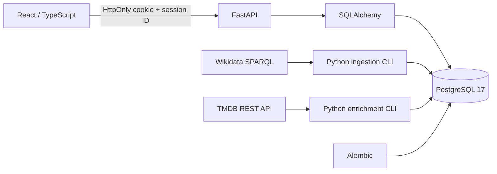

# CineAtlas · Full-stack movie discovery

[](https://github.com/sShahriyaryG/cineatlas-web/actions/workflows/ci.yml)

**v0.5.0 · The New CineAtlas · Development release**

CineAtlas is a full-stack movie discovery and catalog management platform evolved from an IMDb-style Python university project. It combines a relational movie catalog, reproducible data ingestion and enrichment, advanced search, a personal library and dashboard, user reviews, and role-based editorial workflows.

## Features

- **Application workspace:** a personalized signed-in homepage, public film discovery, dedicated Explore and Library destinations, responsive navigation, and context-aware Back actions that preserve search state within a session.
- **Modern Cinematheque:** a shared editorial design system with Light, Dark and System appearance modes, persistent browser preferences, semantic CSS tokens, and system typography.
- **Account security:** persistent revocable sessions, HttpOnly browser cookies, Remember me, active-session management, password changes with inline feedback, authentication rate limits and security event logging. API clients can use bearer authentication.
- **Discover:** title-first keyword search, optional synopsis/actor/director/combined scopes, relevance ranking, multiple genre filters (AND/OR), release-year and community-rating ranges, sorting and pagination.
- **Explore:** dedicated, shareable movie and person pages, linked cast and crew, catalog filmographies, responsive poster cards and image fallbacks.
- **Community:** registration and login, 1–10 movie ratings, reviews with spoiler controls, personal watchlist, private personal ratings, and genre-based recommendations.
- **Editorial tools:** synopsis proposals and status tracking for editors; movie management, member/editor role management, proposal approval, review moderation and statistics for administrators.
- **Data engineering:** Wikidata SPARQL-to-CSV ingestion, optional TMDB REST API enrichment, normalized genre/person/credit relationships, source identity tracking, field-level enrichment provenance, dry runs and repeat-import protection.
- **Quality:** automated backend regression tests, frontend logic tests, TypeScript production builds, and a PostgreSQL migration/API smoke check in GitHub Actions.

## Architecture



The browser uses an HttpOnly session cookie and a non-secret session identifier; the API validates persistent session records and current permissions. External API clients can use bearer credentials. The browser communicates with the application API; external data is acquired by separate backend commands, not by browser-side API calls. Movie ratings and reviews are generated by CineAtlas users, not imported from TMDB.

| Layer | Technology |
| --- | --- |
| Frontend | React 19, TypeScript, Vite |
| Backend | Python 3.12, FastAPI, SQLAlchemy 2, Argon2 password hashing |
| Database | PostgreSQL 17, Alembic; SQLite for lightweight development/tests |
| Data pipelines | SPARQL, CSV, REST, HTTPX |
| Tooling | Docker Compose, pytest, Node.js 22 test runner, GitHub Actions |

## Quick start

Prerequisites: Git and Docker with Docker Compose (Docker Desktop is suitable on Windows). Run from the repository root:

```sh
git clone https://github.com/sShahriyaryG/cineatlas-web.git
cd cineatlas-web
docker compose up -d --build
```

- Web application: <http://localhost:5173>
- API documentation: <http://localhost:8000/docs>
- API health endpoint: <http://localhost:8000/api/health>

The backend applies Alembic migrations on startup. A fresh database starts without the locally imported catalog or user accounts. Populate the catalog using the optional pipeline below, or create movies through Admin Studio. Default Compose credentials and HTTP cookie settings are for local development only; do not expose this setup publicly. Use the same hostname for the web and API (the links above use `localhost`).

To stop the containers while retaining the database, run `docker compose down`. Do not use `docker compose down -v` unless you intentionally want to delete the database volume. Back up important data before upgrades.

### Upgrading from v0.4

Back up PostgreSQL before applying the session-security migration (`0005_session_security`). After updating the source, rebuild both services with `docker compose up -d --build api web` and confirm the Alembic head. The migration adds session, authentication-attempt and security-event tables without replacing existing user or catalog records. Pre-upgrade login credentials are invalidated; sign in again using your existing username and password.

For local authentication and future HTTPS deployment requirements, see [Session security](docs/session-security.md). The default Compose configuration uses HTTP and explicitly trusted local frontend origins.

### Populate the catalog

The repository provides a curated Wikidata query using 60 IMDb title identifiers as lookup keys, without scraping IMDb. Internet access to Wikidata is required for a live fetch; no API key is needed for this step.

```sh
docker compose exec api python ingest_movies.py fetch --output /tmp/wikidata-films.csv --contact https://github.com/sShahriyaryG/cineatlas-web
docker compose exec api python ingest_movies.py import /tmp/wikidata-films.csv --dry-run --strict
```

Review the JSON report before deliberately applying the import:

```sh
docker compose exec api python ingest_movies.py import /tmp/wikidata-films.csv --strict
```

Optional TMDB enrichment adds missing synopses, poster URLs, runtimes and cast/crew. Before running it, obtain the appropriate developer credential and approved attribution logo as described in [Movie enrichment](docs/movie-enrichment.md). Use the same CSV containing `film` and `imdb` columns:

```sh
docker compose exec api python enrich_movies.py /tmp/wikidata-films.csv --limit 3 --dry-run
```

The CLI prompts for an API Read Access Token with hidden input. Review the result, preview the full catalog with `--dry-run`, and use `--apply` only when satisfied. Never commit the token or an enriched database snapshot. Live results depend on upstream data, network access and local records.

An optional legacy CSV importer is separate from this pipeline; `backend/import_legacy.py` imports original movie records from a supplied local legacy ZIP, not original accounts or password hashes. The original dataset is not required to run CineAtlas.

### Create an administrator

Register a normal account in the web application and promote it locally using:

```sh
docker compose exec api python create_admin.py YOUR_USERNAME
```

Sign out and back in to access **Admin Studio**. Admins can promote members to editors; editors sign in to access **Editor Workspace** and submit synopsis proposals. Role checks are enforced on the server. Movie deletion removes associated data, so use disposable records when experimenting.

## Historical catalog integration results

During v0.4 development, a local catalog enrichment run reported:

| Metric | Result |
| --- | ---: |
| Movies matched | 60 / 60 |
| Missing metadata fields filled | 120 |
| Person records created | 823 |
| Cast and crew relationships created | 1,041 |
| External movie identity links created | 120 |
| Reported enrichment issues | 0 |

These are historical integration results, not a bundled dataset, current catalog count, or benchmark. External responses may change. The enrichment process is repeatable without blindly duplicating existing records.

## Tests and CI

With Docker running:

```sh
docker compose exec api python -m pytest -q
docker compose exec web node --experimental-strip-types --test tests/*.test.mjs
docker compose exec web npm run build
docker compose exec api alembic current
```

The v0.5 application-shell acceptance run passed 71 backend tests and 31 frontend logic tests (102 automated regression tests total), including a successful frontend production build. The expected Alembic head is `0005_session_security`. Representative static CSS fixture checks were performed separately; they are not end-to-end React tests.

GitHub Actions runs three jobs: backend tests (isolated SQLite), frontend tests/build, and PostgreSQL migration/API smoke checks against a disposable service database. The PostgreSQL smoke check covers migration/schema consistency, legacy genre backfill, catalog search, person filmographies, authentication/session revocation, private ratings and watchlists. Tests do not need live provider access or private API credentials. Never point the smoke script at your normal application database. See [Continuous integration](docs/continuous-integration.md).

## Project structure

```text
.github/workflows/ci.yml       CI workflow
backend/
  app/                        API, models, auth, search, enrichment
  alembic/versions/           Database migrations
  data/wikidata_films.sparql   Curated source query
  ci/database_smoke.py        Disposable database integration checks
  tests/                     Backend regression tests
  ingest_movies.py            Wikidata extraction and import
  enrich_movies.py            Optional TMDB enrichment
  import_legacy.py            Legacy movie importer
  create_admin.py             Local admin provisioning
frontend/
  src/                        React pages, components and styles
  tests/                      Frontend logic tests
docs/                         Technical documentation
compose.yaml                  Local multi-container environment
```

## Technical documentation

- [Movie ingestion](docs/data-ingestion.md)
- [Catalog data model](docs/catalog-model.md)
- [Movie enrichment](docs/movie-enrichment.md)
- [Catalog search](docs/catalog-search.md)
- [Discovery UI](docs/discovery-ui.md)
- [Continuous integration](docs/continuous-integration.md)
- [Navigation and session isolation](docs/navigation-session.md)
- [Authentication and session security](docs/session-security.md)
- [Modern Cinematheque design system](docs/design-system.md)
- [Application shell and dashboard](docs/application-shell.md)

## Data sources and attribution

Wikidata structured data is available under CC0; see [Wikidata data access](https://www.wikidata.org/wiki/Wikidata:Data_access). TMDB data and artwork are subject to separate terms. This product uses the TMDB API but is not endorsed or certified by TMDB. The application provides attribution; supply the approved logo separately before using the live integration. See [TMDB attribution](https://www.themoviedb.org/about/logos-attribution) and [enrichment documentation](docs/movie-enrichment.md). The repository does not supply API credentials, enriched database snapshots, or downloaded movie artwork. Source-code access does not grant rights to third-party data.

## Limitations and future work

CineAtlas is a development/portfolio project, not a production-ready service or a complete implementation of the original university specification.

- Search uses SQL keyword/substring matching, not full-text indexing or fuzzy search. Larger catalogs may need dedicated indexing.
- Person profiles and filmographies reflect available catalog data; automated metadata refresh and comprehensive person biographies are not implemented.
- Recommendations are genre-based, not an AI or machine-learning recommender.
- Sessions are persistent and revocable, with server-side expiry (24 hours or 30 days with Remember me). Password recovery, email verification, two-factor authentication, security-event retention and comprehensive production security hardening remain future work. Public deployment requires HTTPS, secure cookies, explicit trusted origins and tested reverse-proxy configuration.
- Navigation context is in memory and scroll restoration is best-effort. Theme preferences are browser-local, not synchronized across devices.
- The Library contains watchlist and personal ratings; watched history and custom public/private lists are planned. User profiles, friendships, following, activity feeds, notifications, review reactions and comments are not implemented.
- CI does not replace browser end-to-end, comprehensive PostgreSQL, load or security testing. Dependency locking and branch protection should be reviewed before public deployment.

## Roadmap

| Milestone | Focus |
| --- | --- |
| v0.5.0 | Application foundations, authentication and visual identity |
| v0.6.0 | Expanded cinema catalog, discovery directories and editorial/admin tools |
| v0.7.0 | Profiles, personal collections and community features |
| v0.8.0 | Personalized recommendations and catalog synchronization |
| v0.9.0 | Production readiness, security, performance and accessibility |
| v1.0.0 | Complete movie-platform release |

Future milestones are planned, not implemented. TV series are outside the v1.0 movie-platform scope; hosting and catalog expansion targets remain undecided.
