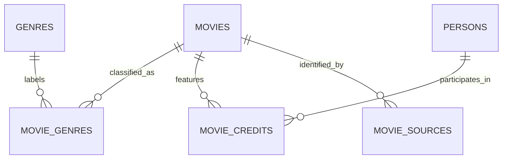

# Relational catalog model

CineAtlas stores movie genres, people and credits as relational data. The movie API still returns a `genres` array, so the existing discovery interface remains compatible.

## Data relationships

- `genres`: integer primary key, unique normalized key, display name.
- `movie_genres`: composite primary key `(movie_id, genre_id)`; indexed genre reference for filtering. A genre can be shared across many films.
- `persons`: integer identity, name and biography. Names are searchable, not unique: different people can have the same name.
- `movie_credits`: references a movie and a person, with a role (`actor`, `director`, `writer`, or `producer`) and optional character name for actors. The combination of movie, person, role and character is unique. A person can have many credits and multiple roles in one film.

Movie deletion removes its genre associations and credits, not the corresponding person or genre records. Unused genres are excluded from the public genre filter. Foreign keys, composite keys and check constraints enforce the relationships. SQLite API tests explicitly check cleanup; PostgreSQL also enforces foreign keys.

## Migration and compatibility

`0003_catalog_relations` creates four tables and backfills shared genre records and links from the existing comma-separated field. It does not change the earlier migrations, recreate movies, or alter existing user activity. Back up persistent data before upgrading. Run the new backend with `docker compose up -d --build api web`; its startup executes `alembic upgrade head`. Verify revision `0003_catalog_relations` using `docker compose exec api alembic current`.

The old physical `movies.genres` column is retained as a bounded compatibility field, not the canonical catalog. Existing raw strings are left untouched during migration. For new writes the application keeps whole labels fitting the 255-character field; longer lists live in the relationships. Historical genres already truncated by older imports cannot be recovered by this migration. Downgrading removes the new tables and therefore loses people, credits and any genre labels that did not fit the old column; prefer a database backup rather than downgrading to recover data.

Use `app.catalog.set_movie_genres` for movie creation or genre edits, within the same transaction as the movie write. The admin API, legacy importer and Wikidata importer all use this helper. Do not update `movies.genres` directly. Concurrent genre insertions use PostgreSQL/SQLite conflict-safe inserts on the normalized key. This does not implement general concurrent editing or ingestion coordination.

Normalization applies Unicode NFKC, whitespace cleanup, case-insensitive keys and known aliases (e.g. `Sci-Fi` and `science fiction film` become `Science Fiction`). Subgenres remain separate. Filters use exact normalized genre identity rather than substring matching. Recommendations use shared genre IDs. New movie inputs permit a genre list up to 4096 characters; normalized names and keys are limited to 512 characters each.

## People and credits API

Browse the interactive API at `http://localhost:8000/docs`.

| Method and path | Permission | Purpose |
|---|---|---|
| GET `/api/persons` | Public | Paginated person search by name |
| GET `/api/persons/{person_id}` | Public | Biography and filmography |
| POST `/api/persons` | Admin | Create a person |
| PUT `/api/persons/{person_id}` | Admin | Edit a person |
| GET `/api/movies/{movie_id}/credits` | Public | Cast and crew |
| POST `/api/movies/{movie_id}/credits` | Admin | Add a credit |
| DELETE `/api/movies/{movie_id}/credits/{credit_id}` | Admin | Remove a credit |

Person creation accepts `{"name":"Example Person","biography":""}`. Credit creation accepts `{"person_id":1,"role":"actor","character":"Example character"}`. Use real IDs returned by the API. A character name is optional for actors and must be empty for other roles. Duplicate credits return HTTP 409. Missing IDs return HTTP 404. Non-admin writes return HTTP 403.

## Tests

`docker compose exec api pytest -q` includes regression tests for migration/backfill, persistence, exact filters, aliases, admin edits, long genre lists, imports, recommendation behavior, duplicate constraints, API permissions and delete cleanup. The tests run with SQLite; verify PostgreSQL migrations and the frontend build separately in Docker.

## Scope

This is the catalog foundation, not the metadata enrichment feature. People/credits start empty and can be managed via the API. A later feature will populate them from an appropriate external source and add dedicated user interfaces. Synopses and posters are not fetched here. There is no person deletion endpoint or external person identity resolution yet.
